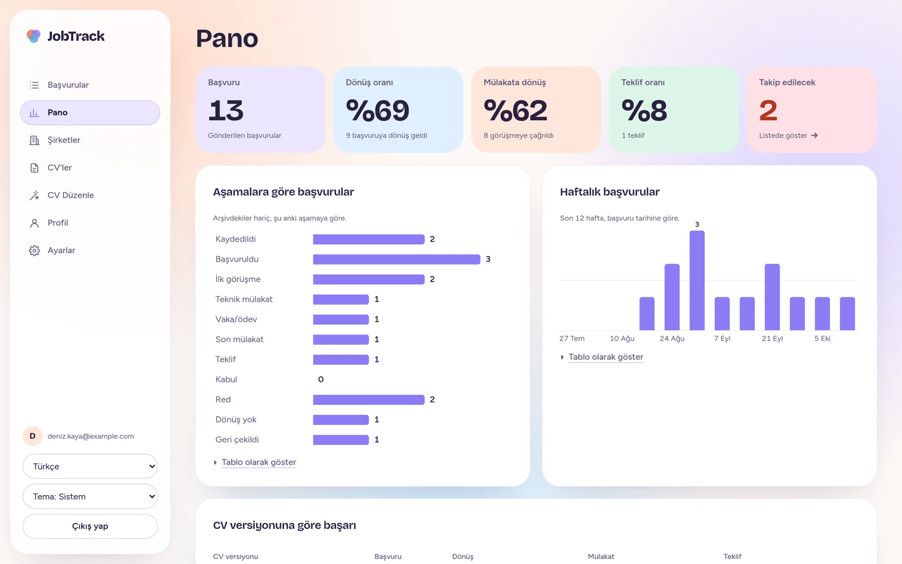
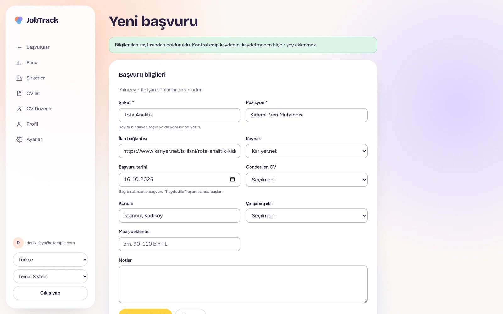
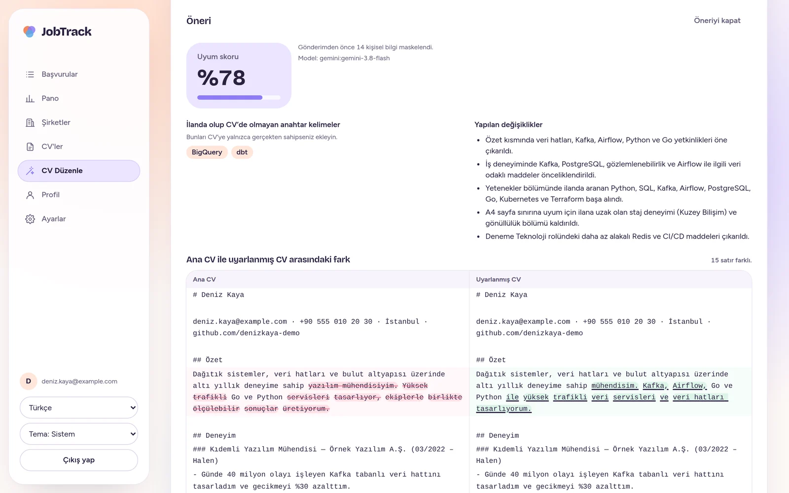
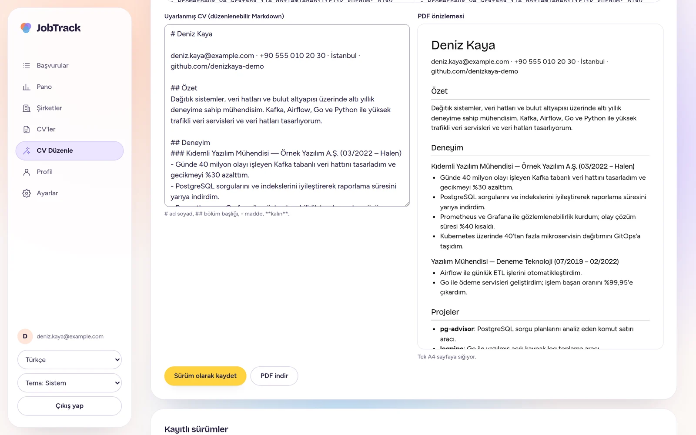
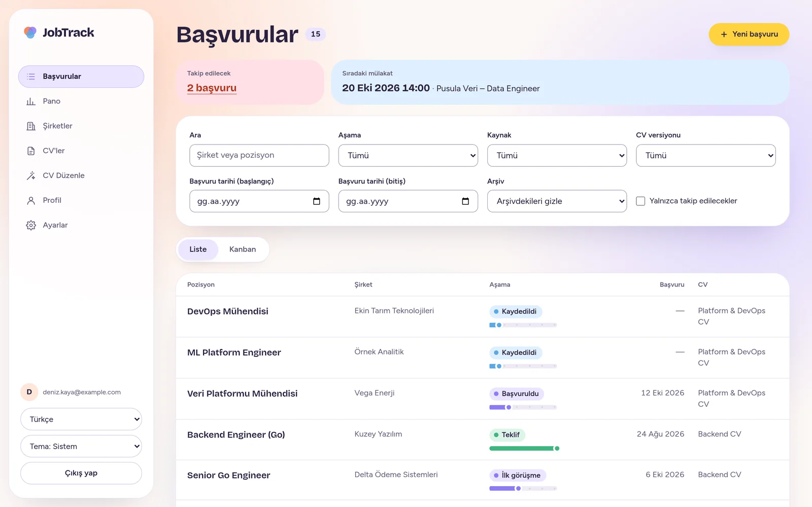
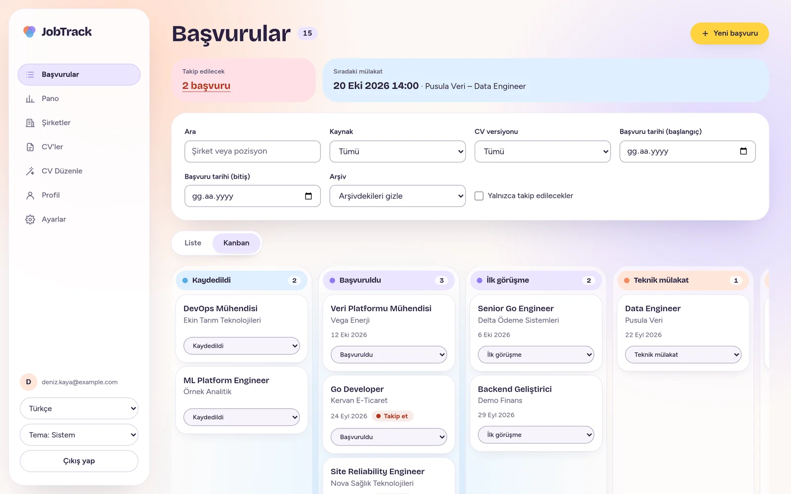
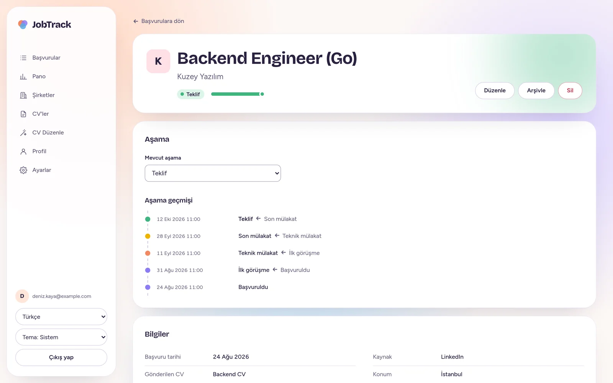
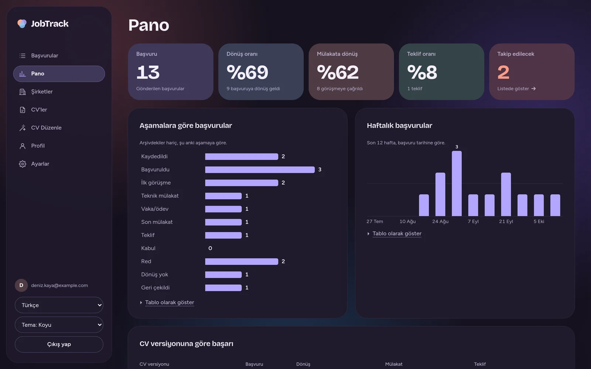
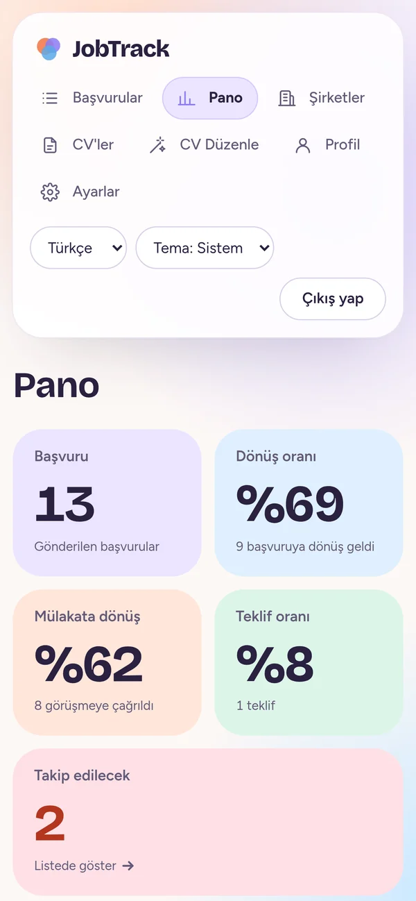
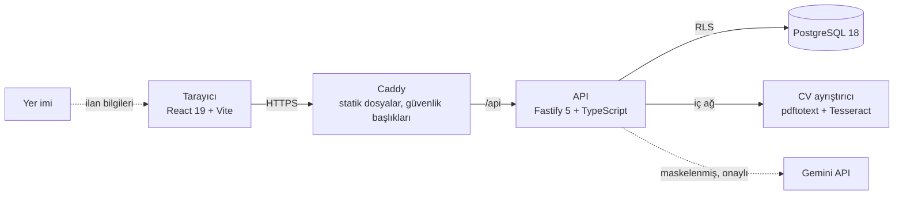

<div align="center">

# JobTrack

**İş arama sürecini tek bir yerde toplayan kişisel başvuru takip uygulaması.**

İlanı tek tıkla kaydet, CV'ni o ilana göre tek sayfaya uyarla, başvurunun her adımını takip et ve neyin işe yaradığını panoda gör.

[](https://github.com/berraslar/jobtrack/actions/workflows/ci.yml)




</div>

## Neden JobTrack?

İş ararken başvurular LinkedIn'e, Kariyer.net'e, e-postaya ve not defterlerine dağılır. Hangi ilana hangi CV ile başvurduğun, kimden ne zamandır ses çıkmadığı ve hangi CV'nin gerçekten dönüş aldığı kaybolur. JobTrack bunların hepsini tek bir düzenli yerde toplar ve her gün ilk olarak neyle ilgilenmen gerektiğini gösterir.

## Öne çıkanlar

### Tek tıkla ilan kaydı

Tarayıcının yer imi çubuğuna eklenen küçük bir yer imi, açık ilan sayfasından pozisyonu, şirketi, konumu, temiz ilan bağlantısını ve **ilan metninin tamamını** okuyup yeni başvuru formunu önceden dolu açar. LinkedIn, Kariyer.net, Youthall ve schema.org `JobPosting` verisi taşıyan şirket kariyer sayfalarında (Greenhouse, Lever, Workday…) çalışır. Kaydı her zaman kullanıcı yapar.



### Yapay zekâ ile ilana göre CV

Ana CV'yi bir kez kaydedersin (PDF'ini sürükleyip bırakman yeter). Bir başvuru seçince yapay zekâ CV'ni o ilana göre yeniden sıralar ve kısaltır; uyum skorunu, ilanda olup CV'de olmayan anahtar kelimeleri ve yaptığı her değişikliği listeler.

- **Uydurma yok:** model yalnızca sıralar, yeniden ifade eder ve çıkarır. Çıktıda Ana CV'de olmayan bir tarih, süre ya da şirket adı geçerse uyarı gösterilir.
- **Gizlilik:** ad, e-posta, telefon, adres ve bağlantılar gönderilmeden önce maskelenir, yanıt gelince geri yerleştirilir. Özellik varsayılan olarak kapalıdır ve her istekte açık onay istenir.
- **Kesintisiz:** model yoğunsa beklemeden yedek modele geçilir; uyarlama birkaç saniye sürer.



### Tek sayfa PDF

Düzenleyicinin yanında, PDF'in birebir aynısı olan canlı bir önizleme durur ve CV'nin tek A4 sayfaya sığıp sığmadığını yazdıkça söyler. Az taşan CV, PDF'te yazı ölçeği küçültülerek otomatik olarak tek sayfaya sığdırılır. Sayfa bütçesi, gerçek yazdırma çıktısı ölçülerek belirlendi.



### Başvuru takibi

| Liste, arama ve filtreler                                                                                       | Kanban                                                                            |
| --------------------------------------------------------------------------------------------------------------- | --------------------------------------------------------------------------------- |
|  |  |

- On bir aşamalı süreç (kaydedildi → başvuruldu → … → teklif); aşama değişiklikleri veritabanında otomatik olarak geçmişe yazılır.
- Kanban'da sürükle-bırak ya da klavyeyle taşıma.
- Mülakat, telefon, e-posta ve ödev kayıtları; yaklaşan mülakatlar takvim dosyası olarak dışa aktarılır.
- Uzun süredir ses çıkmayan başvurular "takip et" olarak işaretlenir.



### Pano

Dönüş, mülakat ve teklif oranları; aşamalara göre dağılım, haftalık başvurular ve hangi CV versiyonunun ve hangi kaynağın daha çok dönüş aldığı, hepsi aşama geçmişinden hesaplanır.

### Açık ve koyu tema, telefonda da

| Koyu tema                                                                | Telefon                                                                             |
| ------------------------------------------------------------------------ | ----------------------------------------------------------------------------------- |
|  |  |

## Güvenlik ve gizlilik

Kişisel veriyle (CV, maaş beklentisi, notlar) çalıştığı için güvenlik baştan tasarlandı; her kontrol [OWASP Top 10:2025](docs/requirements.md) maddelerine bağlı.

- **Veri izolasyonu:** kullanıcıya ait her sorgu PostgreSQL **Row-Level Security** altında çalışır; uygulama kodunda bir hata olsa bile kimse başkasının kaydını göremez. Başkasının kaydına erişim her zaman `404` döner ve bu her uç nokta için test edilir.
- **Kimlik doğrulama:** sunucu taraflı oturum, Argon2id parola özeti, TOTP ile iki adımlı doğrulama, yeni cihazda e-posta kodu, CSRF koruması.
- **Şifreleme:** iki adımlı doğrulama sırları veritabanında AES-256-GCM ile şifreli durur; yedekler [age](https://age-encryption.org) ile şifrelenir ve ayda bir geri yükleme tatbikatı yapılır.
- **Yalıtılmış CV okuma:** güvenilmeyen PDF'ler internete ve veritabanına erişimi olmayan, ayrı bir konteynerde (pdftotext + Tesseract OCR) okunur.
- **KVKK:** tüm veri JSON ya da CSV olarak indirilebilir, hesap kalıcı olarak silinebilir; üçüncü taraf takipçi yoktur.
- **Tedarik zinciri:** imajlar distroless/alpine, SBOM ile yayımlanır ve Sigstore cosign ile imzalanır.

## Kalite

Her değişiklik CI'da şu kapılardan geçer:

| Kapı                          | Araç                                                                                  |
| ----------------------------- | ------------------------------------------------------------------------------------- |
| Lint, tip kontrolü, format    | ESLint (security eklentisiyle, sıfır uyarı), `tsc --strict`, Prettier                 |
| Birim ve entegrasyon testleri | Vitest; API testleri gerçek PostgreSQL ile (Testcontainers), **370+ test**            |
| Uçtan uca ve erişilebilirlik  | Playwright + axe (WCAG 2.2 AA), 360 px mobil kontrolü, Lighthouse                     |
| Güvenlik                      | Semgrep (SAST), Gitleaks, pnpm audit + OSV-Scanner, Trivy (imajlar), OWASP ZAP (DAST) |
| Performans                    | k6 yük testi (1.000 başvuruyla API p95 < 200 ms), ilk yükleme JS bütçesi < 200 KB     |

## Mimari



- **Monorepo** (pnpm workspaces): `apps/api`, `apps/web`, `apps/cv-parser`, `packages/shared`.
- İstemci ve sunucu aynı **Zod** şemalarını paylaşır; her istek iki tarafta da doğrulanır.
- Katmanlı API: `routes → services → repositories`; şema değişiklikleri elle yazılmış SQL migration'larıyla.
- Tüm kararlar [mimari karar kayıtlarında (ADR)](docs/adr/), gereksinimler [`docs/requirements.md`](docs/requirements.md) içinde.

| Katman     | Teknolojiler                                                      |
| ---------- | ----------------------------------------------------------------- |
| Arayüz     | React 19, React Router 7, TanStack Query, Tailwind CSS 4, Vite    |
| API        | Node.js 24, Fastify 5, Drizzle ORM, Zod 4, Argon2id               |
| Veri       | PostgreSQL 18 (Row-Level Security)                                |
| Yapay zekâ | Gemini API (sağlayıcı arayüzü arkasında; yerel model eklenebilir) |
| Altyapı    | Docker Compose, Caddy, GitHub Actions                             |

## Çalıştırma

```bash
./scripts/init-env.sh && docker compose up --build   # http://localhost:8080
```

Yapılandırma, yapay zekâ özelliğini açma, yedekleme ve geliştirme ortamı için: [**docs/kurulum.md**](docs/kurulum.md)

---

<div align="center">

Ekran görüntülerindeki kişi, şirketler ve başvurular uydurmadır.

Geliştiren: [Berra Salar](https://github.com/berraslar)

</div>
